# 아키텍처 안내

[문서 시작](README.md) · [핵심 아이디어](idea.md)

Ontosary의 구조를 이해하려면 **코드 분석**, **도메인 지식의 표현**, **지식의 소비**를 나눠 보면 된다. 코드 분석의 결과가 곧 업무 의미나 agent의 수정 성공으로 이어지는 것은 아니다. 각 경계에서 어떤 자료를 넘기며 무엇을 보장하는지가 중요하다.

확인 기준: **2026-11-09 S2 준비 독립 리뷰**. 아래 첫 그림은 구현된 코어이고, 마지막 그림은 S2의 준비·소비 수명주기다. [독립 리뷰](../reviews/2026-11-09-s2-preparation-independent-review.md)에서 준비·조회·배포 구조와 재현을 확인했으나 제출 코드 평가에는 보완이 필요하다. agent 소비 비교는 아직 실행하지 않았다.

## 1. 구현된 정적 분석 코어

코어는 TypeScript Compiler API로 프로젝트를 읽는다. `Program`은 프로젝트의 소스와 해석 환경을, `TypeChecker`는 선언·타입·심볼 해석을 제공한다. Ontosary는 이를 이용해 근거가 붙은 JSON 자료를 만든다.

[도식 원본](../diagrams/core-pipeline.mmd)

| 구성 요소 | 책임 | 출력의 경계 |
|---|---|---|
| 분석기 | 설정과 소스를 읽고 타입·함수·참조·조건과 근거 추출 | 진단·미지원·분석 범위를 함께 보고 |
| FCA | 함수의 관찰 속성으로 context를 만들고 닫힌 집합 열거 | 업무 개념으로 승인되지 않은 후보 |
| 논리 분석 | 지원 표현식을 논리 IR로 옮겨 유한 입력에서 비교 | 명시적 전제 안에서의 결과와 반례 |
| CLI | 입력 선택, 오류 처리, JSON 출력 | 자료를 사용자에게 전달하는 경계 |

**논리 비교는 임의의 함수를 실행하는 기능이 아니다.** 현재는 제한된 표현식만 다룬다. 비교할 입력이 같다는 명시적 전제와 유한한 값 영역이 필요하다. 함수 전체의 비동기 흐름이나 외부 service 동작을 증명하지 않는다.

**FCA의 포함 관계는 업무 관계가 아니다.** 공통 속성 집합의 포함을 나타내며, 업무상 상속이나 인과관계를 뜻하지 않는다. 현재는 반환된 후보 사이의 모든 엄격 포함 관계를 출력하고, 격자의 인접 관계만 그린 Hasse 도식은 만들지 않는다.

코어는 단일 패키지 안에 있고 CLI와 React 예제는 코어 밖이다. React 예제는 분석 대상이며, 코어가 React의 업무 의미를 이해한다는 뜻은 아니다. 세부 지원 문법·상한·오류 계약과 파일별 책임은 [구현 명세](../ARCHITECTURE.md)에서 관리한다.

## 2. 코드 사실과 도메인 모델 사이

S1 파일럿은 Vendure의 취소·환불 코드에 근거를 연결한 작은 모델을 만들었다. 이 모델의 의미는 agent가 작성한 검토 대기 설명이다. 자동 생성된 완전한 업무 온톨로지나 승인된 정책으로 취급하지 않는다.

아래는 **모델을 읽는 방법의 설명**이다. 실제 S1의 연결을 바탕으로, 탐색 링크·설명·근거가 맡는 서로 다른 역할을 보여준다. JSON 스키마 전체를 그린 그림은 아니다.

[도식 원본](../diagrams/model-evidence.mmd)

S1에서는 ‘환불 경로의 조건부 취소’ 항목이 ‘취소 요청’을 참조한다. 취소 요청에서 incoming 연결을 조회하면 그 설명을 찾을 수 있다. **반대로 찾아갈 수 있다는 것과 업무 관계가 대칭이라는 것은 다르다.** 찾은 설명에서 별도의 fact 참조를 따라 원문을 확인한다.

모델 항목에는 해석, 근거 참조, 미확인 질문, 검토 상태를 함께 둔다. FCA 후보를 연결한 경우에도 그 후보는 공통 관찰을 설명하는 보조 자료다. 모델의 모든 문장을 수학적으로 증명했다는 뜻이 아니다.

세 종류의 ‘같다’도 구분한다.

- 소스 위치가 같은가: 특정 코드 버전 안의 근거 식별 문제다.
- 코드가 같은 속성을 갖는가: 분석 범위 안의 구조적 관찰이다.
- 업무 의미가 같은가: 맥락과 개발자 검토가 필요한 해석이다.

현재 core와 S1은 객체 경계가 다르다. core는 중첩 함수를 별도 함수로 기록하고, S1의 역할 관찰은 중첩 callback의 호출식을 바깥 메서드 원문 영역에 포함한다. 같은 TypeScript 소스를 읽더라도 관찰 정책이 다르면 결과를 그대로 합칠 수 없다. [S1 사용 경로](../../experiments/domain-model/v2/README.md).

## 3. 합의된 S2 구조: 준비와 소비의 분리

S2는 **변경 전 모델이 agent의 코드 수정에 도움이 되는지**를 검증한다. 모델 준비와 agent의 수정 작업을 다른 수명주기로 나눈다. 아래 그림의 준비 경로는 실험 내부에 구현됐다. 소비 단계의 본 비교와 변경 후 모델 갱신은 미실행이다.

[도식 원본](../diagrams/s2-lifecycle.mmd)

**준비 세션**은 한 기준 코드 버전을 검증하는 동안 Program·Checker·진단·소스 근거를 소유한다. 같은 준비 과정에서 이 자료를 재사용하고, 포장이 끝나면 참조를 해제한다. 전체 입력 검증을 근거 구간 몇 개의 검사로 축소하지 않는다.

**동결 모델 묶음**은 기존 모델의 의미·관계·사실·근거·미확인 질문을 담은 JSON 자료다. ‘동결’은 내용을 변경하지 않고 버전과 지문으로 식별한다는 뜻이다. 의미가 완벽하거나 승인됐다는 뜻은 아니다.

**조회 계층**은 묶음에서 항목·한 단계 연결·근거를 찾는다. Compiler API나 파일시스템을 직접 사용하지 않는 순수 모듈로 구현했다. 내부에서는 ID별 Map과 양방향 인접 목록을 사용한다. S2에서는 조회 결과를 파일로 미리 생성해 동일한 파일 도구로 읽게 한다. 전용 서버나 agent 전용 동적 조회 도구는 필요하지 않다.

| 식별자 | 구분하는 것 |
|---|---|
| `baselineId` | 분석 기준 코드와 설정·의존 입력 |
| `modelId` | 해당 기준에 붙인 해석·관계·근거의 내용 |
| `bundleId` | 배포한 파일들과 포장 버전 |

코드가 같아도 해석이 달라지면 모델은 달라질 수 있다. 모델 내용이 같아도 배포 형식이 달라질 수 있다. 세 식별자를 나누는 이유다.

agent가 편집본을 수정한 뒤에도 모델은 **수정 전 코드에 대한 참고 자료**로 남는다. 그 원문 위치를 현재 편집본의 위치라고 표시하거나, 모델을 읽었다는 이유로 수정 결과가 맞다고 판단하지 않는다. 수정 결과는 별도의 평가에서 확인한다. 변경된 코드에 근거를 다시 연결하고 지식을 갱신하는 일은 S3의 후속 범위다.

## 4. 모델의 효과를 검증하는 경계

S2의 비교 조건은 다음과 같다. 정확한 과업·실행 예산·평가 조건은 실행 전에 고정해야 한다.

| 조건 | 공통 코드·기존 문서에 더하는 자료 | 확인할 질문 |
|---|---|---|
| A | 없음 | 기존 도구만으로 어디까지 수행하는가? |
| B | 구조화된 모델 조회 자료 | 모델 패키지가 수정 작업을 돕는가? |
| C | B와 같은 명제·근거·미확인 질문을 담은 일반 문서 | 이점이 추가 정보에서 오는지, 표현·구성도 기여하는지 살펴볼 수 있는가? |

세 조건은 같은 종류의 도구를 사용하고 독립 실행으로 비교한다. 모델 제작 자료와 평가용 정답·테스트는 제공 자료에 섞지 않는다. 단순히 다른 폴더에 두었다는 이유로 접근이 격리됐다고 보지 않는다.

이 비교는 작은 알려진 사례의 파일럿이다. 성공하더라도 모든 프로젝트에 대한 일반화나 FCA의 구축 기여를 입증한 것은 아니다. 표현 형식과 찾기 편의의 영향을 완전히 분리했다고도 주장하지 않는다. 측정은 수정 성공·누락·회귀와 모델 작성·검토·읽기 비용을 함께 다룬다.

## 5. 이 경계를 유지하는 이유

준비와 조회를 분리하면 모델을 읽을 때마다 프로젝트 전체를 컴파일하지 않아도 된다. 사실·탐색 링크·해석을 구분하면 어떤 부분을 검증했고 무엇이 아직 판단인지 드러난다. 실험 모듈을 제품 공개 API와 분리하면 효과가 확인되기 전에 장기 계약을 고정하는 비용을 줄일 수 있다.

현재 S2의 준비 모듈은 타입 검사를 받는 실험 내부 계층으로 구현됐다. 과업·B/C 의미 동등성·oracle 충실성·격리/실행 조건은 별도 검토·동결 전이다. 코드 변경 후의 모델 갱신, 안정적인 ID 재연결, 범용 온톨로지 형식, graph DB, 증분 분석 엔진은 후속 근거가 생긴 뒤 판단한다.

합의의 근거는 [DECISIONS의 ADR-024](../DECISIONS.md), 정확한 구현 범위는 [ARCHITECTURE](../ARCHITECTURE.md), 최근 작업 상태는 [PROGRESS](../PROGRESS.md)에서 확인할 수 있다.
