# 핵심 아이디어

[문서 시작](README.md) · [아키텍처로 이어 읽기](architecture.md)

## 코드에서 바로 드러나지 않는 지식

AI agent가 프로젝트를 수정할 때 필요한 것은 함수의 문법이나 타입만이 아니다. 어느 흐름이 같은 업무 개념을 다루는지, 조건이 왜 존재하는지, 비슷한 이름의 동작이 실제로는 어떻게 다른지도 알아야 한다.

사람에게 읽기 좋은 코드는 agent에게도 도움이 된다. Ontosary는 기존 코드가 agent에게 불리하다고 단정하지 않는다. 출발점은 **코드에 분산되거나 암묵적으로 남아 있는 도메인 지식을, 코드 근거와 함께 참조할 수 있게 만들면 어떨까**라는 질문이다.

예를 들어 주문 화면에는 주문 취소, 환불 중 일부 항목의 취소, 대화상자 닫기가 함께 존재할 수 있다. 이름에 `cancel`이 들어간다고 모두 주문 취소는 아니다. 반대로 이름에 취소가 없더라도 환불 경로 안에 취소 요청이 포함될 수 있다. 올바른 변경에는 이 차이와 연결을 이해하는 일이 필요하다.

## 목표로 하는 흐름

아래는 **개념 설명**이다. 사람이 검토한 지식을 유지하고 agent의 변경을 돕는 목표를 보여주며, 모든 단계가 자동화됐다는 뜻은 아니다.

[도식 원본](../diagrams/idea-flow.mmd)

코드 사실은 직접 읽어 모델을 만드는 데 쓸 수도 있고, FCA나 조건 비교를 거쳐 검토할 수 있다. 이 분석들은 모델 구축을 돕는 선택적인 수단이다. 도메인 지식은 코드만으로 충분히 설명되지 않을 수 있으므로 기존 문서와 개발자의 설명도 필요하다. 출처가 다르면 그 사실도 기록한다.

초기에는 기존 코드 옆에 모델과 근거 연결을 두는 방식으로 시작한다. 이후 코드 구조까지 바꾸는 것이 도움이 되는지는 실제 변경 과업에서 확인한다. 프로젝트 전체를 특정 형식으로 다시 작성하는 것이 도입 조건은 아니다.

## 온톨로지와 FCA의 역할

여기서 온톨로지는 도메인의 **개념·관계·규칙을 명시적으로 표현하는 방법**을 뜻한다. Ontosary에서는 agent가 읽을 수 있고 코드 근거를 추적할 수 있는 도메인 모델을 지향한다. 처음부터 OWL/RDF 같은 표준을 채택해야 하는 것은 아니다.

FCA(Formal Concept Analysis, 형식 개념 분석)는 객체들이 어떤 속성을 함께 갖는지 분석한다. 코드에서 추출한 관찰을 표로 만든 뒤, 공통 속성과 그 속성을 가진 객체의 집합을 함께 찾는다. 여기서 ‘형식 개념’이라는 수학 용어와 ‘주문 취소’ 같은 업무 개념은 구분해야 한다.

| 수단 | 맡기는 일 | 별도로 확인할 일 |
|---|---|---|
| 정적 분석 | 타입·선언·참조·조건식처럼 소스에서 확인할 수 있는 관찰 추출 | 실행 여부, 외부 상태, 업무 의도 |
| FCA | 관찰 속성을 공유하는 집합과 포함 관계 발견 | 집합의 업무상 이름·의미·유용성 |
| 조건 비교 | 지원되는 유한 입력에서 동치·함의·차이와 반례 확인 | 같은 정책을 구현해야 하는지, 차이가 의도인지 |
| 도메인 모델 | 개념·관계·설명·근거·미확인 질문을 함께 표현 | 해석의 적절성, 승인, 코드 변경 뒤 유효성 |

FCA가 개념 후보를 제안해도 이를 어떤 업무 의미로 사용할지는 해석과 검토가 필요하다. 모델이 유용하더라도 FCA가 그 구축 비용을 줄였는지는 별도로 측정해야 한다.

## 작은 표로 이해하는 FCA

다음은 원리를 설명하기 위한 **가상 예시**이며 Vendure의 실제 측정표가 아니다. 각 행은 함수, 각 열은 명시한 범위에서 관찰한 호출식의 존재다.

| 함수 | 취소 호출식 포함 | 환불 호출식 포함 | 대화상자 호출식 포함 |
|---|:---:|:---:|:---:|
| A · 직접 취소 준비 | ✓ | — | ✓ |
| B · 환불 준비 | ✓ | ✓ | ✓ |
| C · 내역 보기 | — | — | ✓ |

FCA는 `{A, B}`와 `{취소 호출식, 대화상자 호출식}`의 쌍을 찾을 수 있다. 두 함수가 공유하는 모든 속성이 오른쪽 집합이고, 그 속성을 모두 가진 함수가 왼쪽 집합이다. 각각을 **extent(객체 집합)**와 **intent(공통 속성 집합)**라고 한다.

여기서 얻은 근거는 ‘A와 B가 같은 관찰 속성을 공유한다’이다. ‘A와 B는 동일한 취소 정책을 구현한다’는 결론은 나오지 않는다. 호출이 조건부인지, 수량이나 권한이 다른지, 예외 처리가 같은지는 추가로 살펴봐야 한다. 표의 `—`도 정의한 관찰 범위에서의 부재이지 모든 실행 경로에서 그런 동작이 없다는 증명이 아니다.

어떤 함수를 객체로 삼고 어떤 관찰을 속성으로 삼을지도 설계 선택이다. FCA를 붙였다고 이 선택이나 모델 작성 비용이 사라지지는 않는다. 실제 S1 파일럿에서는 나온 후보들이 단순 속성 그룹과 같은 객체 집합을 가졌으며, 추가 업무 의미를 발견했다는 증거는 없었다. [S1 검증 기록](../reviews/2026-11-08-domain-model-independent-review.md).

속성 조합에 따라 형식 개념 수는 크게 늘어날 수 있다. 그래서 전체 프로젝트의 모든 속성을 무조건 열거하기보다 과업에 맞는 범위를 정하고 계산·출력 한도를 둔다. 한도에 걸려 일부 결과만 나왔다면 전체 분석이 끝난 것처럼 표시하지 않는다.

## 사실, 후보, 승인된 지식

Ontosary의 중요한 경계는 정보가 무엇을 근거로 어느 정도까지 확인됐는가이다.

| 구분 | 주문 취소 사례에서의 예 | 상태의 의미 |
|---|---|---|
| 코드 사실 | 특정 원문 구간에 취소 service 호출식이 있다 | 명시된 추출 범위에서 확인한 관찰 |
| 발견·해석 후보 | 환불 흐름과 취소 요청을 함께 검토할 필요가 있다 | 분석 결과나 해석이며 검토 대상 |
| 승인된 지식 | 담당자가 의미와 적용 범위를 검토해 수용한 설명 | 누가 무엇을 근거로 승인했는지 기록 필요 |

코드가 관찰되는 방식 자체가 공식 정책은 아니다. 정책과 구현이 어긋날 수도 있고, 모델의 설명이 불완전할 수도 있다. 지식에 출처·범위·미확인 질문을 붙이는 이유다. 소스 hash가 일치하는 것과 업무 의미가 승인되는 것도 서로 다른 판단이다.

## 무엇으로 효과를 판단하는가

검증할 질문은 두 가지다.

- **모델의 사용 효과(H-O):** 같은 코드·도구·예산에서 모델을 참고한 agent가 변경을 덜 놓치고, 회귀와 사람의 재작업을 줄이는가?
- **FCA의 구축 기여(H-F):** 같은 코드 사실에서 직접 탐색·단순 그룹·수동 작성만 할 때보다 FCA가 모델 구축과 검토에 추가 가치를 주는가?

현재는 어느 쪽도 입증하지 않았다. 모델 항목이나 후보의 개수보다 변경 성공, 누락, 잘못된 가정, 검토·갱신 비용을 본다. 모델을 제공하는 데 드는 시간과 읽는 양도 비용이다. 첫 실험은 변경 전 모델의 수정 지원 효과를 보고, 변경 후 모델 유지 비용은 다음 단계에서 다룬다.

원칙과 목표는 [PRODUCT](../PRODUCT.md), 가설과 관찰의 구분은 [RESEARCH](../RESEARCH.md), 실제 모듈 경계는 [아키텍처 안내](architecture.md)에 이어진다.

FCA의 context·extent·intent 정의와 계산 문제는 [Andrews의 In-Close 논문](https://ceur-ws.org/Vol-483/paper1.pdf) 1~2절에서도 확인할 수 있다. 이론 설명의 참고 자료이며 Ontosary가 In-Close를 구현했다는 뜻은 아니다.
